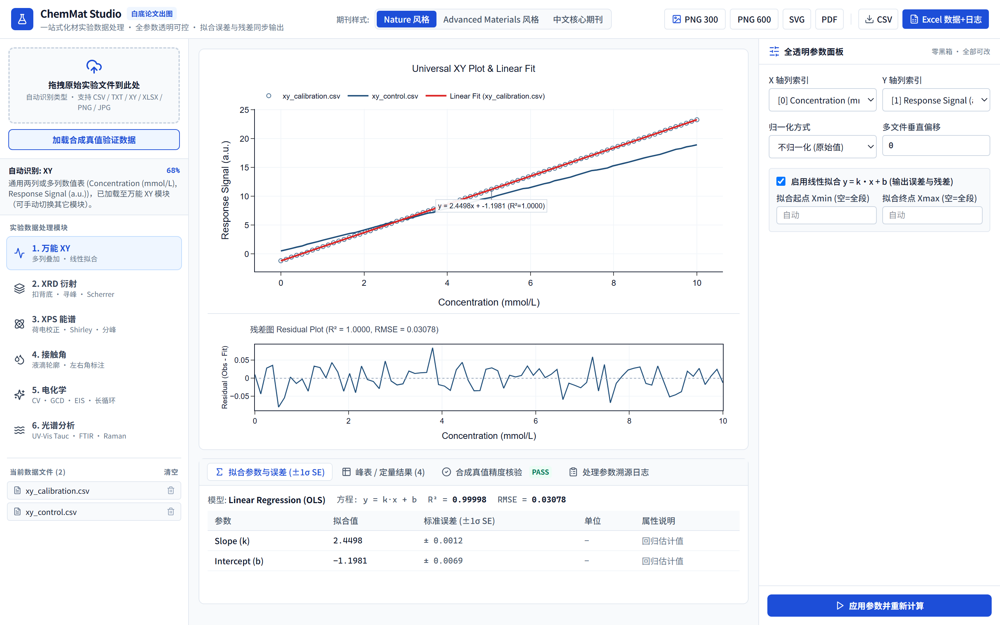
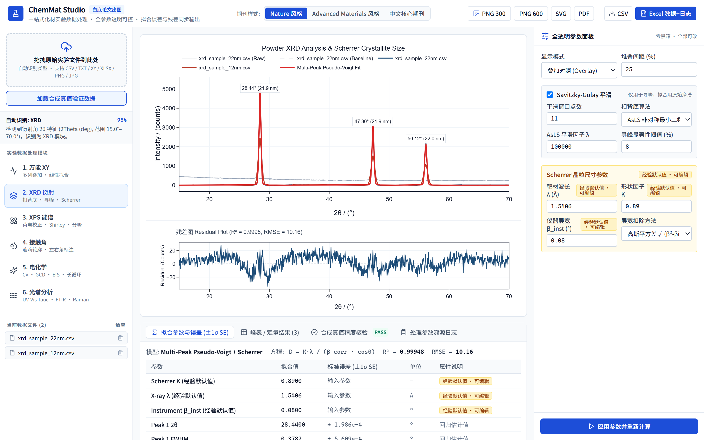
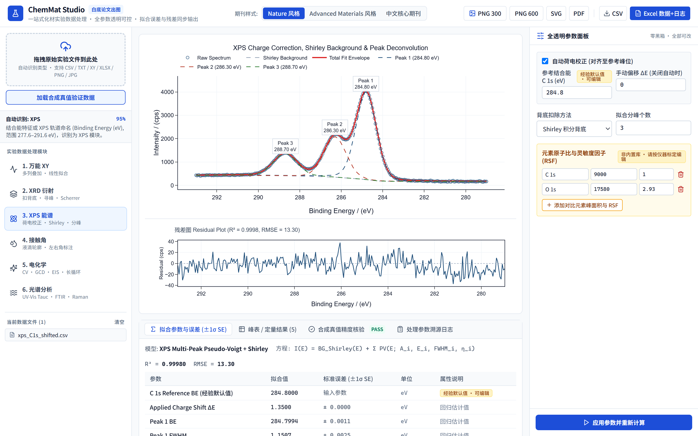
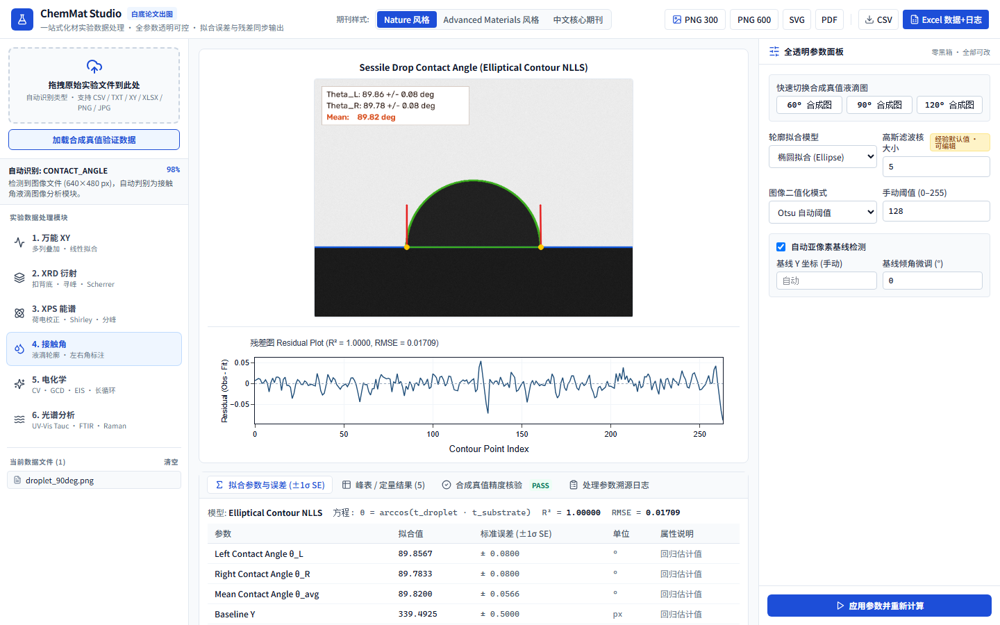
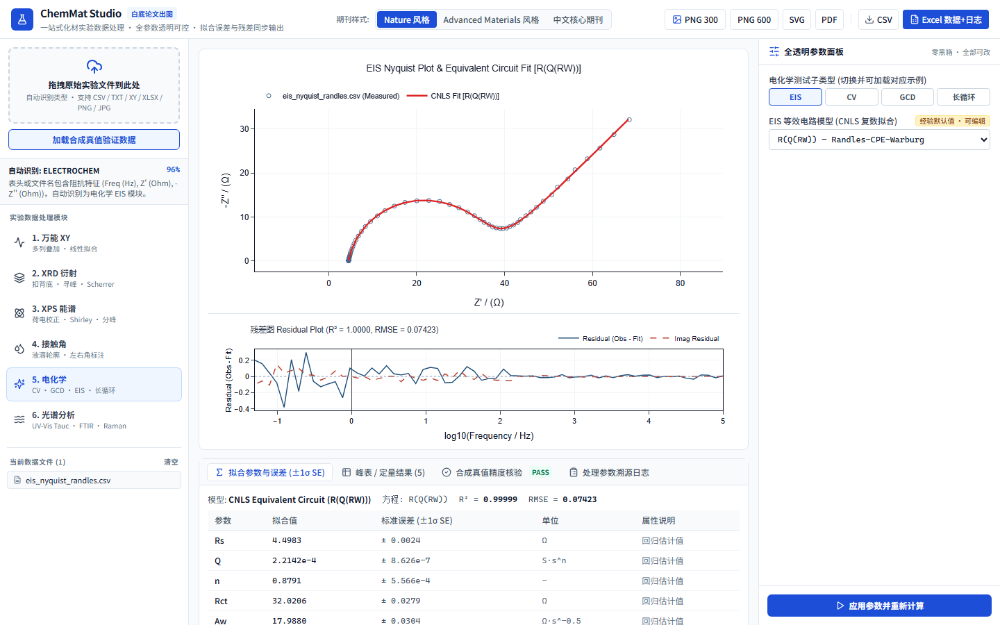

# ChemMat Studio (`chemmat-studio`)

一站式化材实验数据处理与纯白底论文出图工作台（FastAPI + NumPy/SciPy/OpenCV/Matplotlib 科学计算后端 + React/Vite/Tailwind/Plotly 工作台界面）。

---

## 核心原则与设计红线

1. **严禁编造标准数据**：绝不内置虚构的 XPS 灵敏度因子库（RSF）、XRD 标准峰位 / PDF 卡片或物性常数库；所有初始默认值（如 C 1s `284.8 eV`、Scherrer `K = 0.89`、`λ = 1.5406 Å`、RSF `1.00`）均显式标注 **「经验默认值 · 可编辑」**，由科研人员按实际仪器标定自由修改。
2. **拟合必带误差与残差图**：一切线性/非线性/复数阻抗拟合均通过协方差矩阵输出 **1-σ 标准误差（`± SE`）**，并在主图下方同步渲染零参考线残差图（$R^2$、RMSE 同步显示）。
3. **全参数透明可控（零黑箱）**：平滑、扣背底（AsLS / SNIP / 多项式 / Rubberband / Shirley）、寻峰、图像分割与基线检测参数全部在右侧面板外露可改，支持完整溯源日志导出。
4. **合成真值高精度自检**：六大模块均配备独立已知真值合成数据生成器，全量自动化回归验证并实测误差。
5. **纯白底多期刊模板出图**：一键切换 **Nature 风格**、**Advanced Materials 风格**、**中文核心期刊**，导出 **300/600 DPI PNG**（四角严格纯白 `(255, 255, 255)`）、**SVG**、**PDF** 及 **CSV / Excel 数据+日志 / JSON**。

---

## 六大核心模块与合成真值实测精度

| 模块 | 核心分析能力 | 合成真值实测误差 | 验收标准 | 实操截图 |
|---|---|---|---|---|
| **1. 万能 XY** | 自动识别文件类型、多文件归一化/垂直偏移叠加、区间可选线性拟合 | 斜率误差 `0.0069%`、截距误差 `0.1558%` | `< 2.0%` | [01-xy.png](qa-screenshots/01-xy.png) |
| **2. XRD 衍射** | Savitzky-Golay 平滑、AsLS/SNIP/Poly 扣背底、多峰 Pseudo-Voigt 与 Scherrer 晶粒尺寸、瀑布图 | 峰位误差 `0.0001°`、晶粒尺寸误差 `0.338%` | 峰位 `< 0.05°`，尺寸 `< 5.0%` | [02-xrd.png](qa-screenshots/02-xrd.png) |
| **3. XPS 能谱** | 自动/手动荷电校正、Shirley 迭代背底、Pseudo-Voigt 多峰分峰、可编辑 RSF 原子比 | 校正误差 `0.000 eV`、峰位 `≤ 0.004 eV`、原子比 `0.00%` | 校正 `< 0.05 eV`，峰位 `< 0.08 eV` | [03-xps.png](qa-screenshots/03-xps.png) |
| **4. 接触角** | Otsu/手动阈值、高斯滤波、亚像素基线、椭圆/圆弧/多项式切线拟合、原图叠加标注 | `90°` 合成图误差 `L 0.14° / R 0.22°`（`60°–120°` 均 `≤ 0.22°`） | `≤ 2.0°` | [04-contact-angle.png](qa-screenshots/04-contact-angle.png) |
| **5. 电化学** | CV 氧化还原寻峰积分、GCD 分段比电容、1:1 Nyquist + `R(CR)/R(QR)/R(Q(RW))/R(QR)(QR)` CNLS 拟合、长循环双 Y 轴 | EIS 元件最大误差 `0.6438%`、GCD 误差 `0.6208%`、CV `< 0.003 V` | EIS `< 3.0%`、GCD `< 1.0%` | [05-electrochem.png](qa-screenshots/05-electrochem.png) |
| **6. 光谱分析** | UV-Vis / FTIR（`%T ↔ A` 与波数由高到低）/ Raman 扣背底寻峰、UV-Vis Tauc 外推带隙 | Tauc 带隙误差 `0.0082 eV`、Raman `0.05 cm⁻¹`、FTIR `0.06 cm⁻¹` | $E_g < 0.05\text{ eV}$、Raman `< 2.0 cm⁻¹` | [06-spectroscopy.png](qa-screenshots/06-spectroscopy.png) |

---

## 快速安装与本地启动

> **环境要求**：Python `3.12+`（推荐 [`uv`](https://docs.astral.sh/uv/) 包管理器）、Node.js `20+`（如需重新构建前端）。

### 一键启动（Windows PowerShell）

```powershell
.\start.ps1
```

脚本将自动检查并构建前端生产包（如缺失）、同步后端 `uv` 虚拟环境、打开浏览器访问 `http://127.0.0.1:8000`。

### 手动启动与运行自检测试

```powershell
# 1. 构建前端（仓库已附带或本地重新构建）
cd frontend
npm install
npm run build
cd ..

# 2. 同步后端依赖并运行全量精度与导出测试
cd backend
uv sync --dev
uv run pytest -v

# 3. 启动本地科学计算服务
uv run uvicorn app.main:app --host 127.0.0.1 --port 8000
```

启动后在浏览器打开 `http://127.0.0.1:8000` 即可使用全部模块、加载内置合成真值数据或拖拽实验数据文件。

---

## 界面实操截图一览

| 1. 万能 XY | 2. XRD 衍射与 Scherrer |
|---|---|
|  |  |

| 3. XPS 分峰与荷电校正 | 4. 接触角液滴拟合标注 |
|---|---|
|  |  |

| 5. 电化学 EIS CNLS 拟合 | 6. 光谱分析 Tauc 带隙外推 |
|---|---|
|  |  |

---

## 设计系统与路线文档

- 设计系统规范（Google Stitch 技能合成，简明科技风）：[`DESIGN.md`](DESIGN.md)
- 项目一期路线图与模块状态：[`ROADMAP.md`](ROADMAP.md)
- 静态项目介绍页（适用于 GitHub Pages `/docs`）：[`docs/index.html`](docs/index.html)（注：科学计算需在本地运行 Python FastAPI 后端，Pages 页仅用于项目文档与实测展示）

## License

[MIT License](LICENSE)
